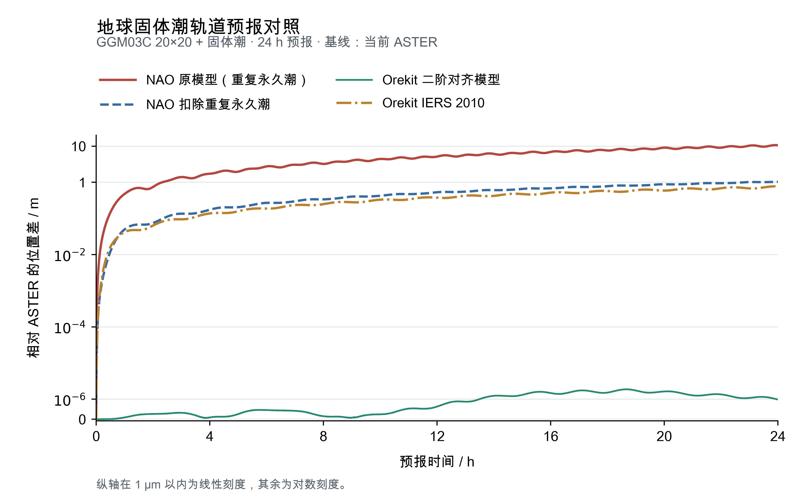

# 版本记录

本文件按发行版本保存重要变化。各程序最近一次科学计算变更所属的版本集中列在[程序变更表](doc/03_programs.md#program-changes)，具体记录保存在下列对应版本中。

<a id="unreleased"></a>

## 未发布

### 文档

- 在现有程序指南中补齐十三个可执行程序和测角加噪工具的变更表，依据 1.0.0 至 1.4.0 的标签差异追溯算法、常数及公共计算的影响，并将表格维护纳入发布检查。
- README 增加紫色首页横幅及 ASTER 全称，文档首页补充程序变更表入口。

<a id="release-1-4-0"></a>

## 1.4.0 — 2026-11-05

本版新增地球固体潮附加修正，以及统一的位置坐标和轨道状态转换入口。固体潮按 GGM03C 的永久潮约定计算，测站转换则与初轨共用同一套坐标接口，便于给外部 Gooding 算法准备一致的输入。

| 受影响的程序或模块 | 本轮变化 | 对现有计算的影响 |
| --- | --- | --- |
| `aster_opn_cartesian`、`aster_opn_nonsingular2` | 可选二阶日月固体潮，扣除 GGM03C 已含的永久部分 | 省略或关闭开关时保留原重力场；开启后加入相应加速度 |
| `aster_convert_coordinates` | 新增大地坐标、ITRS、GCRS 六向批量位置转换，支持度米和度千米 | 为 Gooding 等外部程序提供与 ASTER 初轨一致的测站位置 |
| `aster_convert_states` | 新增 Cartesian、Keplerian、NSG2 六向状态转换，支持度米和度千米 | 复用现有轨道类，保留输入历元与参考系 |
| 公共测站坐标接口 | 补齐错误追踪，地固反算使用 SOFA 处理两极 | 正向 WGS84 与 IAU 2000B 旋转公式保持不变 |
| `aster_iod_gl`、`aster_iod_glml`、`aster_odn_batch` | 共享正向站址接口增加输入检查和错误追踪 | 有效输入的 WGS84 和 IAU 2000B 正转换公式保持不变；现有命令行入口没有启用固体潮 |

公共地球传播接口同步支持 `OrbitPropagationNModel::UseSolidTide`；现有 LEO、HEO 模型预设中的该标志在本版开始实际参与加速度计算。通过 C++ 接口使用这些预设的调用方，需要按所选模型准备 JPL 日月历表及 GGM03C C20。本版的[源码差异](https://github.com/CDC-Official/ASTER/compare/v1.3.0...v1.4.0)与[程序变更表](doc/03_programs.md#program-changes)分别用于追溯实现和查阅各入口最近一次科学变化。

同阶次、同 Love 数条件下，ASTER 与 Orekit 一天预报的最大位置差为 1.87 μm；采用 Orekit 完整 IERS 2010 固体潮模型时，差异为 0.777 m，来自所用固体潮模型的区别。原始 GGM03C 中的永久潮重复项是导师原模型约 10.68 m 位置差的主要来源；剔除后最大位置差降至 1.03 m。条件、四曲线图和原始数据见[固体潮验证](doc/validation/12_earth-solid-tide.md)。



位置坐标与轨道状态的六向互转均通过度米、度千米两套单位下的最小往返检查。状态参数统一为 `cart`、`kep`、`nsg2`，单位通过 `--units deg-m|deg-km` 选择。算例及结果见[转换说明](doc/validation/13_station-coordinates.md)。版本统一随 ASTER 发布，各程序的变化范围按本表记录，实验通过固定提交与构建保存。

**发布检查**：Mac arm64 / AppleClang 21 与 Linux x86_64 / GCC 13.3 的默认 OpenLibm Release 构建均通过，十三程序代表算例及固体潮短算例共 55 份科学输出逐字节一致。详见[1.4.0 发布验收](doc/validation/14_release-1.4.0.md)。

<a id="release-1-3-0"></a>

## 1.3.0 — 2026-11-04

本版围绕地月空间观测仿真展开，并整理了程序多年积累的物理常数。单程测距从真实接收事件出发，利用两颗星的状态和钟差求解发射时刻，再生成接收钟读数与伪距；常数则按动力学、重力场、参考椭球及数值单位分别管理，使每个参数的来源和用途都能查到。

- **地月单程测距**：新增 `aster_generate_cislunar_observations`，支持导航星发射和用户星发射两个方向；输入为 TDB 年月日时分秒、E-BCRS 状态和总钟差，输出观测及完整计算分项。`Cislunar` 提供可复用的状态记录、插值、引力时延和单程伪距计算接口。系统差和白噪声由主程序加入，仓库附两颗星、双向两条观测的最小算例。
- **常数规范化**：近地 GCRS/TT 与地月 E-BCRS/TDB 按各自尺度选取 GM；GGM03C、WGS84、光压参数分别配套使用。`constants::Scale` 明确保存归一化单位，`constants::Conversion` 保存换算系数，来源和用途见[常数说明](doc/11_constants.md)。
- **动力学修正**：补齐近地 Cartesian 和 NSG2 的月球非球形地心间接项，恢复地球圆柱地影；进入阴影后光压为零，离开后恢复，并在运行报告中显示实际设置。
- **验证与记录**：固定状态下对照独立公式、SOFA 和 Orekit；统一模型、持续照明的一天控制试验达到微米级一致。恢复地影后的当前程序，以 10 s ADAMS 步长与导师 NAO 预报 100 天，最大位置差为 75.99 m，末尾为 71.20 m。三步长曲线和自身步长变化保存在[百天对照](doc/validation/10_adams-100days.md)。
- **跨平台一致性**：Mac arm64 / AppleClang 21 与 Linux x86_64 / GCC 13.3 的默认 OpenLibm Release 构建均通过 18 项发布回归；十一程序代表算例共 37 份科学输出全部逐字节一致，包含双向测距观测与物理分项。
- **使用与维护**：补齐程序、配置、数据格式和公共接口指南；更新插值、光压参数和 WGS84 站址测试；十一程序的发布检查可由 `tests/release_smoke.py` 复现。集成此前的 OpenLibm 单目标构建修复，当前程序统一标记为 1.3.0。

### 各程序的科学计算变化

以下记录依据 [`v1.2.0` 至 `v1.3.0` 的源码差异](https://github.com/CDC-Official/ASTER/compare/v1.2.0...v1.3.0)整理。常数整理和物理取值调整分别追溯；表内列出会改变计算模型、参数或数值尺度的部分。

| 程序 | 本版变化及影响条件 | 依据 |
| --- | --- | --- |
| `aster_iod_gl`、`aster_iod_glml` | 使用 WGS84 站址、IERS 2010 TT 地球 GM、由 GGM03C C20 推导的 J2，以及 TT 日月 GM；所选动力学修正按对应参数计算 | [常数定义](doc/11_constants.md)、[常数验证](doc/validation/06_constants.md) |
| `aster_opn_cartesian`、`aster_opn_nonsingular2` | 采用配套的近地 GM 与球谐参数，修正月球非球形地心间接项，恢复圆柱地影，并更新大气及光压参数；相应摄动按配置启用 | [常数验证](doc/validation/06_constants.md)、[近地模型对照](doc/validation/09_orekit-models.md)、[百天对照](doc/validation/10_adams-100days.md) |
| `aster_opn_cislunar` | E-BCRS/TDB 天体引力采用 DE440 GM，配套处理球谐参数的时空尺度，更新光压参数 | [地球 GM 验证](doc/validation/05_earth-gm.md)、[常数验证](doc/validation/06_constants.md) |
| `aster_odn_batch` | 调用的近地传播、WGS84 站址、解析 STM 的 J2 和日月参数随公共计算更新，影响轨道拟合、偏导及后验结果 | [常数验证](doc/validation/06_constants.md)、[发布验收](doc/validation/11_release-1.3.0.md) |
| `aster_generate_observations` | 大地站址使用 WGS84，根数星历转换使用当前 TT 地球 GM；坐标表示、观测角和可见性计算使用更新后的公共参数 | [常数验证](doc/validation/06_constants.md)、[发布验收](doc/validation/11_release-1.3.0.md) |
| `aster_generate_cislunar_observations` | 首次发布；以两星状态、钟差和真实接收事件生成双向单程观测，并提供光行时和理论伪距公共接口 | [测距说明](doc/06_observations.md#cislunar)、[发布验收](doc/validation/11_release-1.3.0.md) |
| `aster_convert_keplerian_to_cartesian`、`aster_convert_cartesian_to_keplerian` | 地球 GM 从 3.986004418×10¹⁴ 改为 3.986004415×10¹⁴ m³/s²，同时配套更新数值尺度；转换公式保持不变 | [常数定义](doc/11_constants.md)、[发布验收](doc/validation/11_release-1.3.0.md) |
| `aster_convert_osculating_to_mean` | 球谐项改用配套 GM 和参考半径，日月项使用 TT GM；同步更新解析田谐自转频率、光压和地影参数 | [常数验证](doc/validation/06_constants.md)、[发布验收](doc/validation/11_release-1.3.0.md) |

`tools/add_angular_noise.py` 在本版的源码与 1.2.0 相同。上游理论观测变化会改变该工具的输入及由文件摘要派生的随机种子，逐样本复现时仍需固定理论文件和 Python 环境。

直接调用库的代码需要更新旧常数名称，迁移对应表见[常数说明](doc/11_constants.md#从旧常数名称迁移)。配置继续使用各入口规定的物理单位；本次修正带来的轨道变化及比较条件见[常数验证](doc/validation/06_constants.md)。发布构建和跨平台结果集中在[1.3.0 验收记录](doc/validation/11_release-1.3.0.md)。

<a id="release-1-2-0"></a>

## 1.2.0 — 2026-11-02

- 从 CDC_lib 当前实际入口迁入 `aster_generate_observations`：读取 Cartesian/Keplerian 星历和测站，逐历元使用 EOP，执行高度角、可选黑夜/地影筛选，生成理论 RA/Dec 弧段、同历元真值及可选完整观测。输入单位、ID 分弧和输出格式保持原定义。
- 迁入 `tools/add_angular_noise.py`，保留东西/南北等标准差小角度模型、标准库随机流、原种子派生与来源记录。原 NumPy 论文批次使用另一随机流，seed 不作样本对应。
- 新入口接入公共 OPENLIBM/SYSTEM 数学后端及版本查询；CMake 正式版本为 1.2.0。沿用 ASTER 的显式 `-I` 配置入口，替代旧程序的本机默认路径；弧段写出进入公共 `include/`、`src/`。
- 复用原 LEO 算例与运行、几何、加噪验收，补充理论/带噪观测至 GL、GLML 的实际交接检查；用法见 [观测生成](doc/06_observations.md)。
- Mac/Linux 原观测检查和 GL/GLML 资料交接通过；OPENLIBM 下 19 份理论/真值、12 份固定 seed 带噪文件及 8 份定轨科学输出逐字节一致。Mac SYSTEM 与旧库原二进制的 19 份输出一致，Linux 同后端旧/新入口受控比较的 19 份输出一致；范围和末位差异见 [观测生成](doc/06_observations.md)。
- 发布与维护：两端 main 使用同一套源码和同一发布提交；v1.0.0、v1.1.0 标签原指向保留。main 为唯一长期分支，feature/、fix/ 分支在验收合并后清理；未合并的独有修改保留。

本版的科学计算新增集中在观测生成与配套加噪工具。根据 [`v1.1.0` 至 `v1.2.0` 的源码差异](https://github.com/CDC-Official/ASTER/compare/v1.1.0...v1.2.0)，原有九个程序及其调用的既有科学公式、常数和数学后端保持不变。

<a id="release-1-1-0"></a>

## 1.1.0 — 2026-11-02

- **公共数学后端**：九程序、公共 core 与 SOFA 共用 `math_backend`，通过 `ASTER_MATH_BACKEND=OPENLIBM/SYSTEM` 选择，默认官方 OpenLibm 0.8.8；`--version` 显示版本、后端和构建条件。
- **计算规则**：Ljung–Box 调用注释保留，未计算 Q/p 为 −1。科学公式、残差/J、原门限、迭代上限及按最小 J 选优的规则保持不变。
- **平台与依赖**：已验证 Mac arm64 / AppleClang 21、Linux x86_64 / GCC 13.3，Boost 1.87.0 与现有 OpenMP。需要 CMake ≥3.26、C++17；Eigen 3.4.0、SOFA 2018-01-30、OpenLibm 0.8.8 固定源码及许可随库保存。
- **验证范围**：代表输入下九程序 OPENLIBM 的 Mac/Linux 科学输出逐字节一致；七个非 IOD 程序同平台前后差异满足原物理门限。两端各 8 项核心/SOFA、4 个单 GL 逐轮检查、2 个各 10001 候选的完整 GLML 通过，SYSTEM 坐标/SOFA 各 2 项通过。敏感 GL/GLML 的轨迹与候选可能改变。e010 四样本中普通 GL 和三组 GLML 基本不变，3″、27秒短弧 GLML 换候选后误差下降，但新来源仍达 40 轮上限，位置误差约 93.720 km；这些结果不推广为所有场景更准确。
- **效率备忘**：九程序已有计时保留在[后端验收](doc/validation/03_math-backend.md)。完整 e070 GLML 的 Mac 中位耗时 5.063→6.372 s（+25.8%），Linux 4.109→3.995 s（−2.8%）；Linux 两个地球预报增加约 118%—120%，瞬时根数转平根数的 Mac/Linux 增加约 170%/132%。毫秒级程序百分比噪声较大。后续优先分析这些热点，并继续保持现有数值验收门限；本版不追加性能试验。
- **版本管理**：每台机器日常只用原 ASTER 仓库，通过标签和对应构建目录切换版本。`v1.0.0` 保持原提交，`v1.1.0` 为正式 annotated 标签。历史试验保存在本地备份/stash，不混入 main；GitHub 自动提供源码归档，本版不附未经验证的安装器或二进制包。

本次公共数学后端变更覆盖 1.0.0 已有的九个程序，其科学变化均记入 1.1.0，具体实现见[相邻版本源码差异](https://github.com/CDC-Official/ASTER/compare/v1.0.0...v1.1.0)：

| 程序 | 科学计算变化 |
| --- | --- |
| `aster_iod_gl`、`aster_iod_glml` | 切换公共数学后端及浮点规则；Ljung–Box 的 Q/p 字段统一标为 −1。残差、J 和候选选优规则保持原定义 |
| `aster_opn_cartesian`、`aster_opn_nonsingular2`、`aster_opn_cislunar` | 传播、摄动及相关 SOFA 调用共用所选数学后端与浮点规则 |
| `aster_odn_batch` | 传播、残差、法方程等计算共用所选数学后端与浮点规则 |
| `aster_convert_keplerian_to_cartesian`、`aster_convert_cartesian_to_keplerian` | 根数和直角坐标转换共用所选数学后端与浮点规则 |
| `aster_convert_osculating_to_mean` | 解析摄动与根数转换共用所选数学后端与浮点规则 |

逐程序数值与平台对照见[数学后端验收](doc/validation/03_math-backend.md)。

默认 OPENLIBM 构建：

```sh
cmake -S . -B build/v1.1.0 -DCMAKE_BUILD_TYPE=Release
cmake --build build/v1.1.0 --parallel 3
build/v1.1.0/bin/aster_iod_gl --version
```

SYSTEM 使用单独构建目录，并添加 `-DASTER_MATH_BACKEND=SYSTEM`。移动 OPENLIBM 程序时，一起移动同目录私有 `libopenlibm.dylib` / `libopenlibm.so`。测试脚本现从 CMake 读取项目版本；旧 1.0.0 字节 fixture 保留，完整旧 CTest 不作为数学路径切换后的通过标准，当前命令见[测试说明](tests/README.md)。

<a id="release-1-0-0"></a>

## 1.0.0 — 2026-11-01

建立独立 ASTER 工程，收录九个轨道研究程序。GL、GLML 采用已整理的实验版实现，预报和批处理保留当前科研流程与输出规则。状态转换的短输入检查在主程序中展开。

统一构建入口、程序名称与三段版本号，最小算例集中到 `tests/`。JPL、EOP、月球重力场和大气数据随 `data/` 保存，记录来源和校验值。Eigen 固定 3.4.0，SOFA 固定 2018-01-30。

本版作为上述九程序的 ASTER 初始基线。后续变化从相邻发行标签及对应公共实现追溯，程序最近一次科学计算变化汇总在[程序变更表](doc/03_programs.md#program-changes)。

GLML 包含迁移前已验证的弧度回退修复，以及可记录、可复现的 `random_seed`。源码来源和实际验收结果见 [迁移记录](doc/validation/01_index.md#migration)。
