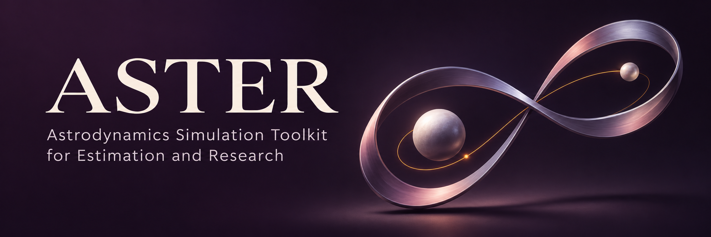

# ASTER 1.4.0

ASTER 的全称为 **Astrodynamics Simulation Toolkit for Estimation and Research**，意为“用于轨道估计与研究的天体动力学仿真工具库”。

ASTER 是用于轨道研究的个人 C++ 程序库，包含 GL/GLML 初轨确定、地球与地月数值预报、批处理定轨、轨道状态转换、瞬转平，以及地基光学观测生成、地月双向单程测距仿真和配套加噪工具。

当前正式版本为 1.4.0。Mac 和 Linux 共用源码，各自在本机编译；日常使用 main，正式版本由标签保存。

## 使用入口

从[文档首页](doc/01_overview.md)选择任务。第一次使用按下面的顺序阅读：

1. [快速上手与构建](doc/02_quick-start.md)：Mac/Linux 编译、CLion、跑出第一份结果。
2. [程序使用](doc/03_programs.md)：各主程序怎样选，如何准备配置、运行和查看结果。
3. [配置参考](doc/04_configuration.md)与[数据格式](doc/05_data-formats.md)：关键词、列序、单位、参考系、时间尺度与结果字段。
4. [公共接口参考](doc/07_interfaces.md)：在自己的 C++ 主程序中调用计算，包含参数说明和示例。

常数的来源、计算用途和旧名称迁移见[物理常数与模型参数](doc/11_constants.md)。本版的验证汇总见[1.4.0 发布验收](doc/validation/14_release-1.4.0.md)。

从星历开始做仿真可直接读[观测生成](doc/06_observations.md)。源码组织、测试和简单 Git 工作流见[开发维护](doc/09_development.md)，既有 Linux 环境的操作见[服务器指南](doc/10_server.md)。

## 编译与第一个小算例

在现有 Mac 环境的仓库根目录执行：

```sh
cmake -S . -B build/v1.4.0 -DCMAKE_BUILD_TYPE=Release
cmake --build build/v1.4.0 --parallel 3
build/v1.4.0/bin/aster_iod_gl --version
mkdir -p build/quick-start
build/v1.4.0/bin/aster_convert_keplerian_to_cartesian \
    tests/convert_keplerian_to_cartesian/input.txt build/quick-start/cartesian.txt
```

转换结果为 UTC MJD 加位置（m）和速度（m/s），保存在 `build/quick-start/cartesian.txt`。服务器需要追加现有 Boost 路径，完整命令见[构建指南](doc/02_quick-start.md)。

环境需要 CMake 3.26 及以上、C++17 编译器、Boost 头文件和 OpenMP，检查与加噪工具使用 Python 3。Eigen 3.4.0、SOFA 2018-01-30、OpenLibm 0.8.8 源码及许可随库保存。默认数学后端为 OPENLIBM，程序与同目录私有共享库一起使用；开关与已有平台对照见[数学后端](doc/08_math-backend.md)。

## 目录与维护资料

| 位置 | 用途 |
| --- | --- |
| `apps/` | 各主程序 |
| `include/`、`src/` | 公共接口与科学实现 |
| `cmake/`、`third_party/` | 构建接入、固定第三方源码与许可 |
| `tests/` | 最小输入、参考结果与[检查说明](tests/README.md) |
| `data/` | EOP、JPL、月球重力场、大气资料与[来源校验](data/README.md) |
| `doc/` | 日常指南、接口参考与[验证资料](doc/validation/01_index.md) |
| `tools/` | 测角加噪工具 |
| `build/` | 本机编译与运行结果，Git 忽略 |

版本内容统一见 [CHANGELOG](CHANGELOG.md)，当前发布见 [v1.4.0](https://github.com/CDC-Official/ASTER/releases/tag/v1.4.0)，代码修改规则见 [AGENTS.md](AGENTS.md)。
