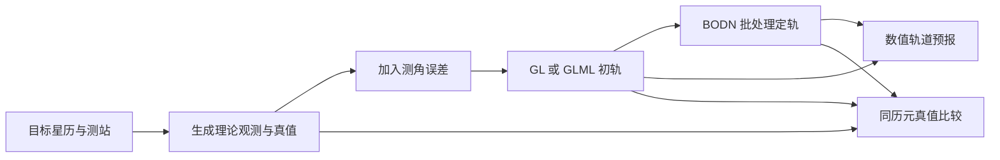

# ASTER 文档

ASTER 是用于轨道研究的 C++ 程序库。可以直接运行命令行程序，也可以在自己的主程序中调用公共计算接口。第一次使用先完成一个小算例；准备实验时，再按任务查配置、数据格式和结果含义。

## 从哪里开始

| 你要做什么 | 阅读位置 | 能找到什么 |
| --- | --- | --- |
| 编译程序，跑出第一份结果 | [快速上手与构建](02_quick-start.md) | Mac/Linux 命令、版本查询、最小转换算例、CLion 设置和常见错误 |
| 选择程序并运行已有算例 | [程序使用](03_programs.md) | 各入口的用途、命令、配置起点、输出和结果判断 |
| 修改 setting.txt | [配置参考](04_configuration.md) | 关键词、取值、单位、条件项，以及不同程序的差别 |
| 准备观测、星历、测站和初轨 | [数据格式与计算约定](05_data-formats.md) | 文件列序、单位、时间尺度、参考系、残差和轨道解格式 |
| 从星历生成观测并加噪 | [观测生成](06_observations.md) | 地基测角与地月测距、可见性筛选、状态输入、钟差和随机种子 |
| 在自己的 C++ 主程序中调用计算 | [公共接口参考](07_interfaces.md) | 链接方法、参数方向、归一化、返回状态和调用示例 |
| 理解数学后端与平台差异 | [数学后端](08_math-backend.md) | OPENLIBM/SYSTEM 开关、共享库、浮点设置与验收依据 |
| 修改源码、做检查、保存版本 | [开发与 Git 维护](09_development.md) | 源码组织、测试入口、临时分支、提交和版本标签 |
| 在现有 Linux 服务器工作 | [服务器使用与同步](10_server.md) | 既有目录、SSH、构建、实验目录和 Git bundle 中转 |
| 追查迁移、诊断和验收依据 | [验证资料索引](validation/01_index.md) | 独有科学验证、适用版本与原始 JSON 的对应关系 |

推荐的阅读顺序是：先读[快速上手](02_quick-start.md)，再选[对应程序](03_programs.md)，最后查[配置](04_configuration.md)和[数据格式](05_data-formats.md)。需要写 C++ 调用代码时，进入[接口参考](07_interfaces.md)。

## 各模块怎样衔接

地基测角的仿真定轨实验通常从已知轨道开始。先准备目标星历和测站，生成理论观测并保存同历元真值，再按指定误差模型加噪。GL 或 GLML 使用带噪资料求初轨；后续可用 BODN 改正轨道，或用预报程序生成新的星历。定轨精度通过同一历元、同一参考系下的轨道真值评价。

真实观测可以直接进入初轨或批处理入口。状态转换程序用于改变轨道的表示，瞬转平程序用于按所选模型取得均根数。文件接续时先核对列序：例如预报星历有七列，而观测生成器的输入还需要一列整数 ID；具体见[数据格式](05_data-formats.md)。

## 文档怎样分工

日常指南直接放在 `doc/`，按阅读顺序以 `01_`、`02_` 等两位数开头，前缀后使用小写英文，词间用连字符。编号是本项目的阅读约定。快速上手和两端构建合在同一篇，后续依次介绍程序、配置、数据、观测生成、接口、后端和维护。

`validation/` 集中保存有独立用途的科学验证与原始证据。旧操作指南和重复阶段说明通过 Git 历史查看，当前有效结论已进入对应指南；[验证资料索引](validation/01_index.md)说明每类资料的用途与版本。

仓库其他入口各有自己的用途：

- [根 README](../README.md)：项目简介和常用入口。
- [CHANGELOG](../CHANGELOG.md)：统一的版本变更记录。
- [tests/README.md](../tests/README.md)：检查命令、比较方式和参考结果来源。
- [物理常数与模型参数](11_constants.md)：参数来源、分组和各计算场景的选用方式。
- [data/README.md](../data/README.md)：公共科学数据的用途、覆盖时间和校验清单。
- [third_party/README.md](../third_party/README.md)：固定第三方源码及其许可。
- [AGENTS.md](../AGENTS.md)：修改科研代码时遵循的规则。

本套指南对应 1.2.0 源码。命令默认从 ASTER 仓库根目录执行；`build/v1.2.0` 是本版既有构建目录，运行结果也放在 `build/` 下。

地月单程测距从两颗星的状态、钟差和真实接收事件生成观测，输入输出见[观测指南](06_observations.md#cislunar)。当前 GL、GLML 与 BODN 的观测类型分别在[数据格式](05_data-formats.md)中说明。
