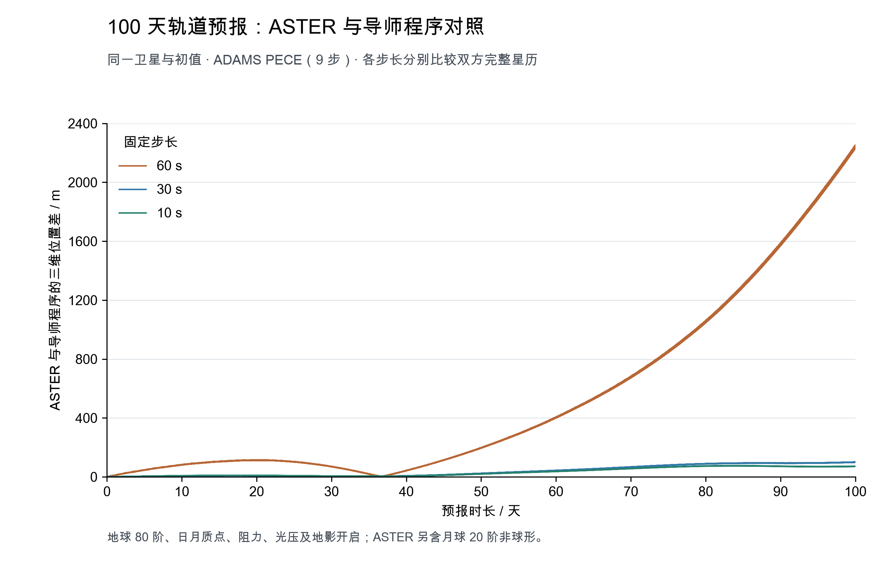

# 与导师程序的百天 ADAMS 预报对照

本记录用于后续版本发布时查阅长期预报对照结果。比较双方为当前 ASTER 与导师 NAO 程序；使用同一颗卫星、同一有量纲初值，分别按 60、30、10 秒步长积分 100 天。



## 运行条件

- ASTER：`fix/earth-gm-conventions` 分支，基于 `406294200eb808221fe430adc6b750b403a140b5` 的工作区，包含常数整理、月球非球形间接项和圆柱地影恢复；具体可执行文件校验值见证据。
- 初始 UTC MJD：55255.99923398。位置 [5937.3763146517094, 2716.356956252755, 1644.074813304293] km；速度 [-3.5084830876880702, 4.594869895007859, 5.1343051912384086] km/s。
- 双方采用 ADAMS PECE、9 步、定步长；ASTER 积分 Cartesian，NAO 积分 NonSingular2。
- 共同开启地球 GGM03C 80 阶、日月质点、大气阻力、光压及各自的圆柱地影模型。ASTER 另开启月球 20 阶非球形；导师的固体潮、经验力保持关闭。
- 双方使用同一 EOP、DE430 文件和相同卫星参数。各自保留现行常数、地球姿态及大气实现。

## 图与数值

每条曲线表示同一步长下 `||位置_ASTER − 位置_NAO||`，单位 m。各组使用完整 Cartesian 星历，分别有 144001、288001、864001 个规则网格点，没有平滑或抽点。图中使用线性坐标。

| 固定步长 | 百天内最大位置差 / m | 百天末位置差 / m |
| --- | ---: | ---: |
| 60 s | 2252.548117 | 2242.140199 |
| 30 s | 101.006971 | 99.688931 |
| 10 s | 75.993517 | 71.195528 |

按相同名义经过时间配对，未插值调整打印历元。三组最大历元差分别为 15.09、52.18、72.92 微秒。ASTER 的 30、10 秒结果末尾有一次微小补齐步，绘图时用实际终点替换最后一个规则网格点。

双方各自比较 30 秒与 10 秒结果，百天末变化分别为 ASTER 470.33 m、NAO 499.02 m。因此，这张图记录的是两程序的一致性及其随步长的变化；积分收敛情况应结合上述自身步长对照判断。

## 保存与复现

- [PNG](figures/adams_100days_comparison.png)、[PDF](figures/adams_100days_comparison.pdf)、[SVG](figures/adams_100days_comparison.svg)。PDF/SVG 的文字、坐标轴可编辑，完整曲线以 450 dpi 图层保存。
- [绘图脚本](evidence/13_plot-adams-100days.py)、[运行与原始文件校验记录](evidence/13_adams-100days.json)。
- 原始星历、输入配置和日志保存在项目工作目录 `04_代码工作/实现观测量仿真/导师百天对照_014/`；证据记录各文件的绝对路径和 SHA-256。

复现时指定上述原始资料目录：

```sh
python doc/validation/evidence/13_plot-adams-100days.py --data-dir <原始资料目录> --output-dir doc/validation/figures
```

绘图依赖 NumPy、Matplotlib；中文字体可根据运行环境调整。图已检查文字可读性、标签间距和数据统计，PDF 无文字碰撞。

## 提交验收前的构建与回归

旧插值测试已改为调用当前 `Cislunar::InterpolateState`，检查三维位置、速度、钟差、窗口切换、首末端点及跨日历元；JPL 拆分日期的微秒位移检查保留，错误通过 Tracer 记录。默认全目标构建通过。

恢复地影后，原光压参数估计场景的一组拟合残差超过门限。该测试改用冬季 5° 倾角的连续受光高轨，并检查每个资料时刻的照明条件；原有残差、参数恢复、协方差和积分敏感性门限保持原值。三个光压估计变体的 WRMS 分别约为 0.000206、0.000206、0.000216，测试通过。圆柱地影的阴影内外判定仍由独立重力约定测试覆盖。

本轮 16 项核心及相关检查均已通过，覆盖坐标转换、解析平均项、批处理和参数估计、RKF78、ADAMS、初轨、SOFA、资料完整性、非法输入、观测几何与噪声、地月插值和测距。首轮的参数测试失败日志与修正后日志均保留；[提交前检查记录](evidence/14_preacceptance-checks.json) 给出逐项状态、测试修改和源码校验值。
