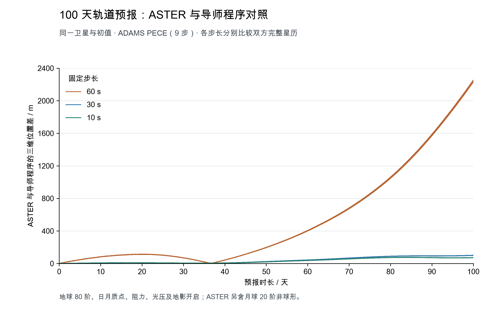

# ASTER 1.3.0 发布验收

本版在 `bc9d45c` 已验收的科学实现上补齐使用文档、版本信息和发布检查。单程测距、常数管理、月球非球形间接项与圆柱地影的实现均已进入本次发布。

## 科学计算的验证依据

| 核对内容 | 比较双方与结果 | 详细记录 |
| --- | --- | --- |
| 常数、单位、坐标与力计算 | 独立有量纲二体/J2、SOFA WGS84、光压与阻力公式均通过 | [常数验证](06_constants.md) |
| 地球非球形引力 | 同一 ECEF 状态下，ASTER 与 Orekit 的 80 阶最大加速度分量差为 1.21×10⁻¹⁷ m/s² | [Orekit 基础对照](07_orekit.md) |
| 近地摄动逐项及组合 | 共享模型和环境输入，一天最大位置差为 0.71～12.72 μm | [逐项对照](08_orekit-perturbations.md) |
| 月球非球形地心间接项 | 修正后 Cartesian、NSG2 与同模型 Orekit 一天最大位置差为 1.14、4.85 μm | [间接项复核](09_orekit-models.md#近地间接项修正后的复核) |
| 当前带地影的百天预报 | 双方均用 10 s ADAMS PECE，ASTER 相对导师 NAO 最大差 75.99 m、末尾差 71.20 m | [百天三步长对照](10_adams-100days.md) |

一天摄动对照中，光压采用持续照明；当前发布程序已经恢复圆柱地影，百天结果使用恢复后的实现。各自更换大气、姿态和光压模型的影响，以及百天积分的步长响应，均在相应记录中单独列出。



## 发布构建与跨平台检查

本次使用默认 OpenLibm 后端，在 Mac 和现有 `cdc-114` Linux 环境分别构建，并运行相同的代表输入。`tests/release_smoke.py` 检查十一程序的版本、帮助和科学输出；核心、资料、观测及测距回归按当前条件执行。

两端使用同一候选提交 `6053eb657d4dcc574a61dd72a241f3292156cbf9` 的计算源码，后续整理更新了文档、测试预设和一处重复字注释，计算标记保持一致。

| 发布检查 | Mac arm64 / AppleClang 21.0.0 | Linux x86_64 / GCC 13.3.0 |
| --- | --- | --- |
| 默认 Release 全目标构建 | 通过 | 通过 |
| 核心、SOFA、输入、资料与观测回归 | 18 项通过，0 项失败 | 18 项通过，0 项失败 |
| 十一程序版本与帮助 | 全部通过 | 全部通过 |
| 十一程序代表算例 | 全部正常完成 | 全部正常完成 |
| 同名科学输出 | 共 37 份，与 Linux 逐字节一致 | 共 37 份，与 Mac 逐字节一致 |

37 份输出包括 GL/GLML 解与残差、候选表、BODN 残差、近地和地月星历、状态转换、瞬转平、光学观测及真值、双向单程测距观测及完整分项。GLML 使用两个线程；测距组采用零噪声。所有对应文件的 SHA-256 均相同。

文档中的 11 段 C++ 示例编译通过，265 个本地链接检查通过。[发布证据](evidence/15_release-1.3.0.json) 保存两端逐项结果、源文件与输入校验值。原始运行资料保存在各平台的 `build/v1.3.0/acceptance/` 中，发布过程的清理归档保存在项目工作目录 `发布收尾_016`。

## 怎样复现

从仓库根目录执行：

```sh
cmake -S . -B build/v1.3.0 -DCMAKE_BUILD_TYPE=Release -DBUILD_TESTING=ON
cmake --build build/v1.3.0 --parallel 3
ctest --test-dir build/v1.3.0 \
    -R '^(core_|math_backend_sofa|invalid_inputs|data_integrity|iod_batch_handoff|observation_|cislunar_|gravity_conventions)' \
    --output-on-failure -j 3
python3 tests/release_smoke.py --bin-dir build/v1.3.0/bin \
    --output build/v1.3.0/acceptance/local
```

`--output` 指向新的目录，以保存这一轮实际配置、科学结果和日志。两端 `summary.json` 中相同文件的 SHA-256 用于逐字节比较。GLML 固定两个 OpenMP 线程；测距使用零噪声，比较两个方向的观测和全部物理分项。

## 本次整理的内容

程序入口、配置、数据格式和公共接口继续在原编号指南中维护，常数用途集中在 `11_constants.md`，独有验证资料集中在本目录。修正了旧插值测试接口、光压参数测试的照明场景，并把光学站址等价性检查中的固定 ECEF 坐标与 WGS84 配套。

两个过时的临时构建目录已完整压缩归档、核对文件数量和大小后移出 ASTER；Python 缓存已清理。正式版本构建、CLion 配置、最小算例和独有实验结果继续保留。
