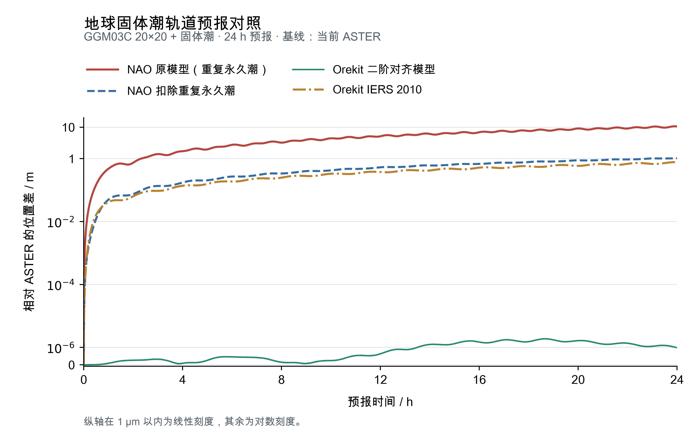

# 地球固体潮实现与验证

ASTER 的两套 GCRS/TT 地球轨道预报已接入日月二阶弹性固体潮。新增加速度只包含原始 GGM03C 之外的潮汐修正，GGM03C 球谐系数、GM 和参考半径均保持原值。省略或关闭固体潮开关时，本轮检查的科学输出与修改前的 ASTER 逐字节一致。

固定相同位置和物理参数后，ASTER 与导师 NAO 原函数的加速度吻合。一天预报中，两套程序各自开关固体潮产生的轨道变化不同；控制试验确认，其中约 9.7 m 的差别来自永久潮处理。统一为完整二阶潮汐贡献后，双方开关增量的最大位置差为 0.0754 mm。

## 模型与永久潮处理

日月引力使地球发生形变，形变引起的质量分布变化进一步改变卫星所受的地球引力。本次采用频率无关的二阶弹性模型，Love 数为 0.3，滞后角为零，与本机 NAO 实际使用的 General 模型对应。

计算先取得当前时刻的日月地心位置，再将日月和卫星位置统一到地固系，计算形变造成的二阶引力变化。日月 GM 复用 ASTER 已有的 DE440 TT 相容值，模型参考半径取 GGM03C 的 6378136.3 m。势函数展开依据 [IERS 2010 第6章式6.6](https://iers-conventions.obspm.fr/content/chapter6/icc6.pdf)，加速度采用该势函数的向量梯度。

[CSR 的 GGM03 官方说明](https://download.csr.utexas.edu/pub/grace/GGM03/GGM03_Notes.pdf)明确指出，原始 C20 采用零潮汐系统，已经包含永久潮贡献；转换为无潮汐系统时应加上 4.173×10⁻⁹。因此，本次保留原始系数，在新增加速度中扣除 C20=-4.173×10⁻⁹ 对应的永久部分。这与 IERS 第6.2.2节对零潮汐静态场的组合方法一致。

| 配置 | 地球引力的组合 |
| --- | --- |
| `use_solidtide_perturb` 省略或为 0 | 原始 GGM03C，包含其已有的永久贡献 |
| `use_solidtide_perturb = 1` | 原始 GGM03C＋当前完整二阶潮汐贡献－已含的永久部分 |

附加修正要求静态场实际包含 C20，即 `earth_zonal_order` 至少为 2。固体潮使用 JPL 日月位置，开关独立于日月直接引力开关；直接引力采用解析历表时，也保持其原有选择。近地 JPL 查询继续采用以 TT 近似 TDB 的现有约定。

## 比较对象和算例

修改前基线为 ASTER `main` 的 `3e88b79cca030c65405bbd495234483a480ed832`，工作区干净。新增实现位于 `feature/earth-solid-tide`。源码校验、各次运行的二进制校验、配置及科学文件校验保存在[原始证据](evidence/16_earth-solid-tide.json)中。

固定点参考直接编译本机 NAO 的 `gaussLib/accel_solidtide.cpp` 和追踪实现后生成。五组输入包含低轨、高纬和高轨位置；生成参数、列序和源文件 SHA-256 保存于 `tests/earth_solid_tide/source.json`。这项比较统一了实际位置、日月 GM、参考半径、Love 数和滞后角。

一天轨道比较使用本机 `NAO/cmake-build-release/opnApp/opnApp`。初始历元为 UTC MJD 55255.99923398，双方使用同一组 km、km/s 初态：

```text
位置：5937.3763146517094  2716.356956252755  1644.074813304293
速度：-3.5084830876880702  4.594869895007859  5.1343051912384086
```

双方均开启地球 80×80 引力与 JPL 日月质点引力，使用同一份 EOP 和 DE430 文件，步长为 10 s，预报 86,400 s，输出 8,641 个历元。为单独检查固体潮，阻力、光压和月球非球形在本算例中关闭。常规比较使用定步长 RKF78，另用 ASTER 九节点 Adams PECE 核对积分结果。

两套程序各自保留地球引力参数、日月 GM 和地球姿态实现。ASTER 的地球 GM 为 3.986004415×10¹⁴ m³/s²，模型半径为 6378136.3 m；NAO 使用其原有的 3.986004418×10¹⁴ m³/s² 和 6378137 m。两套程序关闭固体潮时，一天最大位置差已为 1.02810 m。

## 加速度和开关检查

| 比较内容 | 最大差异 |
| --- | --- |
| 相同输入与参数：ASTER 加回永久部分后，与 NAO 完整二阶潮汐加速度比较 | 3.54×10⁻²⁰ m/s²，按分量统计 |
| 五个固定点：ASTER 附加加速度与独立势函数的五点中心差分梯度比较 | 1.61×10⁻¹⁸ m/s²，按分量统计 |
| Cartesian 右函数的开关增量与核心函数直接计算比较 | 1.08×10⁻¹⁶ m/s²，按分量统计 |
| NSG2 右函数的开关增量与直接投影、高斯行星方程比较 | 1.11×10⁻¹⁶，归一化状态导数分量 |

独立势函数检查同时覆盖地轴两极。动力学检查分别采用日月直接引力关闭、JPL、解析历表和两种混合设置，所得固体潮增量均对应同一份 JPL 日月位置。

另外，以修改前的 ASTER 为基线，两套入口分别运行既有 600 s 算例和一天算例。600 s 配置省略新开关，一天配置显式填写 0；四次运行的 Cartesian、Keplerian、NSG2 科学文件共 12 份，均逐字节一致。配置错误检查覆盖非法开关、非整数开关、缺失或不可读的 JPL 文件及静态场缺少 C20；无效位置检查确认错误调用链保留，输出数组保持原值。

## 一天轨道结果

下表均比较相同时刻的位置向量，先求三维位置差，再统计最大值和末点值。“开启减关闭”表示同一程序只切换固体潮开关。

| 比较双方 | 最大位置差 | 末点位置差 |
| --- | ---: | ---: |
| ASTER Cartesian：开启减关闭 | 15.42696 m | 14.67774 m |
| ASTER NSG2：开启减关闭 | 15.42695 m | 14.67773 m |
| NAO：开启减关闭，采用完整二阶潮汐贡献 | 23.74504 m | 23.74504 m |
| ASTER Cartesian 与 NSG2：均开启附加修正 | 0.00597 mm | 0.00563 mm |
| ASTER RKF78 与 Adams PECE：均开启附加修正 | 0.21281 mm | 0.20699 mm |
| ASTER 与 NAO：均关闭固体潮，分别采用各自模型 | 1.02810 m | 1.02810 m |
| ASTER 与 NAO：均开启固体潮，分别采用各自模型 | 10.67666 m | 10.58038 m |

为解释开关增量的差别，验证时在构建目录生成一个诊断副本，仅去掉永久加速度的扣除，其他计算保持一致。该副本计算完整二阶潮汐贡献，用于与 NAO 的模型对齐。开发分支中的正式实现仍返回附加修正。

| 隔离永久潮的比较 | 最大位置差 | 末点位置差 |
| --- | ---: | ---: |
| 同一 ASTER：完整潮汐诊断副本与正式附加修正比较 | 9.70589 m | 9.60499 m |
| ASTER 完整潮汐诊断副本与 NAO：分别取各自的“开启减关闭”后比较 | 0.07536 mm | 0.07459 mm |

原始开关增量的最大差别为 9.70583 m。单独改变永久潮处理后，位置变化为 9.70589 m；统一为完整二阶潮汐贡献后，增量差降至 0.07536 mm。这组控制结果将永久潮约定造成的差别与加速度实现、双方原有模型差异区分开来。

## 构建与复查入口

默认 Release/OpenLibm 构建通过，当前回归预设的 19 项检查全部通过。补充检查确认，两套主程序在关闭日月直接引力、静态场取 2/0 时，也能独立加载 JPL 并计算固体潮。最终构建已实际运行仓库内的最小配置，其 8,641 行 Cartesian 星历与上述已验证的潮汐开启结果逐字节一致。

最小配置及运行方法见 [`tests/earth_solid_tide/README.md`](../../tests/earth_solid_tide/README.md)。核心检查通过 `ctest --test-dir build/release -R '^core_earth_solid_tide$' --output-on-failure` 运行，配置失败检查并入 `invalid_inputs`。完整输入、星历、报告和诊断副本保存在本机 `build/release/solid-tide-validation/`。

## 与 Orekit 的 20×20 固体潮比较

本组比较采用上述 ASTER 固体潮工作区与 Orekit 13.1、Hipparchus 4.0.1。双方只开启地球质点引力、原始 GGM03C 20×20 静态场和固体潮，关闭日月直接引力、阻力、光压及月球非球形。日月位置只用于驱动地球固体潮。双方共用初态、EOP、每次计算时刻的 ASTER 地固姿态和 DE430 日月位置，地球及日月 GM、模型半径也一致。预报一天，每 10 s 比较一次，共 8,641 点。

先把 Orekit 的二阶实 Love 数统一设为 0.3，其余响应设为零，并采用与 ASTER 相同的永久 C20=-4.173×10⁻⁹。潮汐改正系数由 Orekit 原始 `SolidTidesField` 计算，加速度由 `HolmesFeatherstoneAttractionModel` 计算。五个固定点上，双方固体潮加速度最大分量差为 **2.65×10⁻²² m/s²**；20×20 静态非球形加速度最大分量差为 1.24×10⁻¹⁶ m/s²。

| 比较双方及条件 | 一天最大位置差 | 一天末位置差 |
| --- | ---: | ---: |
| ASTER 与 Orekit：均关闭固体潮 | 8.15 μm | 8.15 μm |
| ASTER 与 Orekit：相同二阶固体潮模型 | **1.87 μm** | **0.983 μm** |
| ASTER 与 Orekit：各自取“开启减关闭”后比较，相同二阶模型 | 7.17 μm | 7.17 μm |
| ASTER 二阶模型与 Orekit 完整 IERS 2010 固体潮 | 0.776882 m | 0.776413 m |
| Orekit 内部：完整 IERS 2010 与二阶简化模型比较 | 0.776883 m | 0.776414 m |

ASTER 使用定步长 RKF78、10 s 步长。Orekit 使用 DP853；二阶模型的步长上限从 7.5 s 减为 3.75 s 后，最大位置变化为 1.56 μm。统一模型后的微米级差异与本次积分差异处于同一量级。

完整 IERS 2010 一侧使用 Orekit 公共 `SolidTides`，保留原有 Love 数、频率修正、三阶潮汐和二阶引起的四阶响应，采用零潮汐静态场对应的永久项扣除；单独的极潮关闭，潮汐系数按实际评估时刻直接计算。源码依据为 [SolidTidesField](https://www.orekit.org/site-orekit-13.1/xref/org/orekit/forces/gravity/SolidTidesField.html)及 [SolidTides](https://github.com/CS-SI/Orekit/blob/13.1/src/main/java/org/orekit/forces/gravity/SolidTides.java)。在 Orekit 内部单独切换这两种潮汐模型，也产生约 0.777 m 的一天位置变化，确认这部分来自潮汐模型差异。

这组结果确认了 ASTER 当前二阶模型的实现正确性，也给出了它与完整 IERS 2010 模型在本算例中的差别。生产计算源码保持本轮已验证的状态。本组源码校验、参数、配置和统计见[原始证据](evidence/17_solid-tide-orekit.json)，完整验证程序与星历保存在 `build/release/solid-tide-orekit/`。

## 四套程序或模型相对 ASTER 的位置差曲线

下图以当前 ASTER 为基线，采用同一颗测试卫星，仅考虑 GGM03C 20×20 和固体潮，展示一天内的三维位置差。ASTER 与两组 Orekit 直接复用前述星历，本次只补齐 NAO 原模型和扣除重复永久潮后的两组星历。



| 相对 ASTER 的比较对象 | 最大位置差 | 一天末位置差 |
| --- | ---: | ---: |
| NAO 原固体潮模型，包含重复永久潮 | 10.6764 m | 10.5799 m |
| NAO 扣除重复永久潮 | 1.02775 m | 1.02775 m |
| Orekit 二阶对齐模型 | 1.87360 μm | 0.98313 μm |
| Orekit IERS 2010 | 0.776882 m | 0.776413 m |

NAO 的固体潮计算与日月直接引力共用同一循环。为使图中所有算例都只包含指定的两项摄动，两份绘图副本均跳过日月直接引力的累加，同时保留日月位置用于驱动固体潮；后一份再扣除永久 C20 对应的加速度。原始 NAO 文件保持原样，两条曲线均保留其原有 GM、参考半径和地球姿态。因此，扣除重复项后的约 1 m 位置差仍包含这些设置的影响。

图中保留全部 8,641 个历元。纵轴表示相对 ASTER 的位置差，在 1 μm 以内采用线性刻度，其余采用对数刻度。[CSV 源数据](figures/solid_tide_20_comparison.csv)、[绘图脚本](figures/plot_solid_tide_comparison.py)、[PDF](figures/solid_tide_20_comparison.pdf)和 [SVG](figures/solid_tide_20_comparison.svg)与图片一起保存；文件校验和来源见[图件记录](evidence/18_solid-tide-figure.json)。
