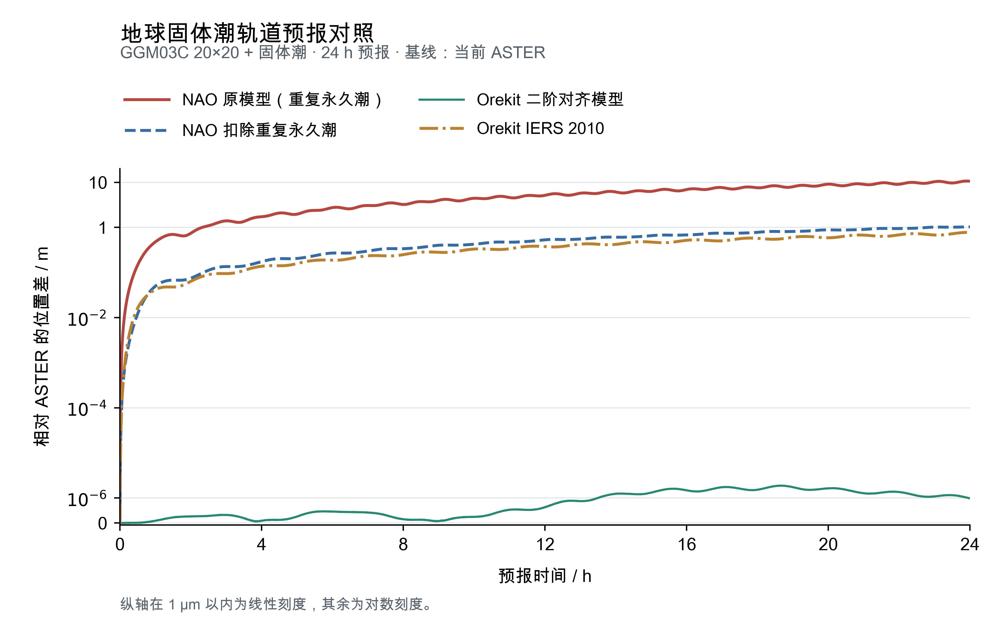

# ASTER 1.4.0 发布验收

本版的地球固体潮附加修正已经通过同模型对照，统一坐标与轨道状态入口也通过了两套单位下的最小往返检查。Mac 与 Linux 上十三个程序的代表算例及两套地球固体潮短算例共五十五份科学输出逐字节一致，发布构建可以用于后续实验。

## 科学结论与程序影响

本版保持原始 GGM03C 系数，开启固体潮时只叠加它尚未包含的二阶日月贡献，扣除已含的永久潮部分。相同初态、GGM03C 20×20 和相同二阶响应下，ASTER 与 Orekit 一天最大位置差为 **1.87 μm**。NAO 原模型的永久潮重复项是约 **10.68 m** 位置差的主要来源；扣除该项后，最大位置差降为 **1.03 m**。Orekit 完整 IERS 2010 与本版简化模型的最大差异为 **0.777 m**，在 Orekit 内部单独切换两种模型也得到相同量级的变化。



图中均以当前 ASTER 为基线，只考虑 GGM03C 20×20 和固体潮，采用同一颗卫星的物理初态。NAO 保留自身的 GM、参考半径和地球姿态。完整条件、四条曲线的数据与来源见[固体潮验证](12_earth-solid-tide.md)。本次发布复用已完成的这些对照。

`aster_convert_coordinates` 提供大地坐标、ITRS、GCRS 六向位置互转；`aster_convert_states` 通过 `cart`、`kep`、`nsg2` 选择三种轨道表示。两个入口都提供 `deg-m`、`deg-km`，六向互转和往返检查通过。最小输入与说明见[坐标算例](../../tests/convert_coordinates/README.md)、[状态算例](../../tests/convert_states/README.md)。

GL、GLML 的求解算法保持原样。本版继续采用统一库版本号，CHANGELOG 按程序列出本次变化；论文实验固定实际提交、构建、配置和输入数据。

## 发布构建与跨平台检查

两端使用科学实现提交 `f27671d1a6dfe9596eeab4d84461596811fc2d3a`，后续发布收尾只更新说明、证据与公告。数学后端、Eigen 和 SOFA 版本保持现有配置。

| 检查项目 | Mac arm64 / AppleClang 21 | Linux x86_64 / GCC 13.3 |
| --- | --- | --- |
| 独立的 1.4.0 Release 全目标构建 | 通过 | 通过 |
| 固体潮核心、配置错误与转换最小往返 | 3 项通过 | 3 项通过 |
| 十三程序的版本、帮助和代表算例 | 通过 | 通过 |
| 两套地球入口：20×20＋固体潮，600 s | 通过 | 通过 |
| 同名科学输出 SHA-256 | 55 份与 Linux 全部一致 | 55 份与 Mac 全部一致 |

五十五份输出包括原有三十七份科学结果、新增位置与状态转换各六份，以及 Cartesian、NSG2 地球入口的固体潮短算例各三份。短算例仅开启 GGM03C 20×20 与固体潮，步长为 10 s，输出 Cartesian、Keplerian、NSG2 三种星历。

[发布证据](evidence/20_release-1.4.0.json)保存源码提交、两端逐文件校验、输入清单与图件哈希。各平台的 `build/v1.4.0/acceptance/` 保存实际配置、日志和科学结果；本机也保留 Linux 校验清单及本次检查脚本。

常规复查从仓库根目录执行：

```sh
cmake -S . -B build/v1.4.0 -DCMAKE_BUILD_TYPE=Release -DBUILD_TESTING=ON
cmake --build build/v1.4.0 --parallel 3
ctest --test-dir build/v1.4.0 -R '^(core_earth_solid_tide|conversion_roundtrips|invalid_inputs)$' --output-on-failure
python3 tests/release_smoke.py --bin-dir build/v1.4.0/bin --output build/v1.4.0/acceptance/new-run
```

## 清理与保存

已清理 Python 缓存、本轮一次性代码生成脚本和已失效的转换目标构建文件。源码、公共数据、CLion 配置、版本构建和用户手动算例均保留；固体潮的独有实验结果及图件源数据按现有目录保存。提交后以干净的 main 发布，`v1.4.0` 固定指向本次发布提交。
