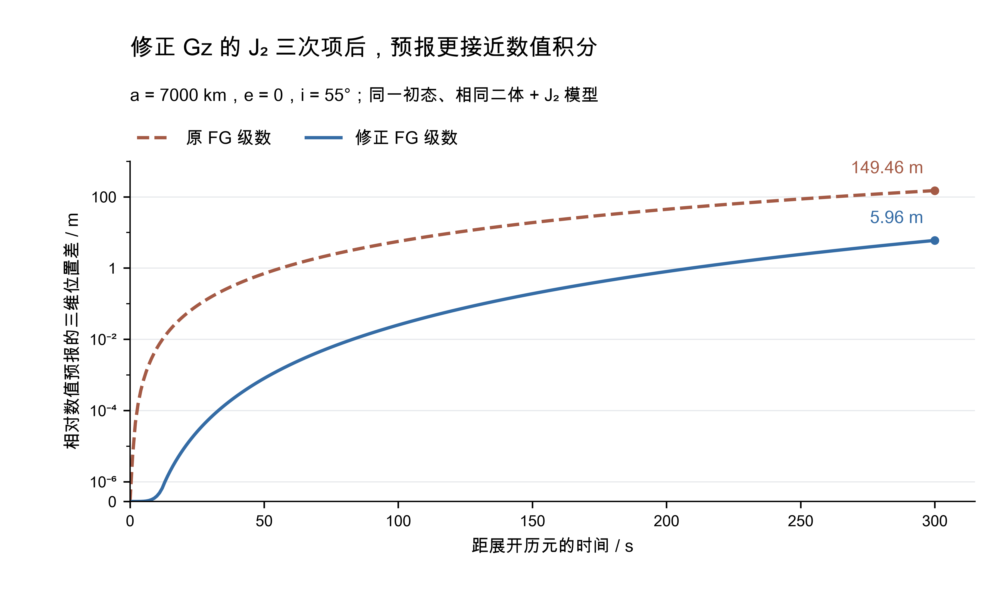

# GL 的 J₂ 三次项修正与验证

本次修正 **FG 级数中 $G_z$ 的 J₂ 附加三次项**：分母由 2 改为 $3!=6$。GL、GLML 共用的四个含 J₂ 分支均已修改。以同一初态、相同二体＋J₂ 模型的数值积分为基准，低轨算例 300 s 的三维位置差由 **149.46 m 降至 5.96 m**。独立求导证明与原生 C++ 回归检查共同确认了修正依据。

## 错误的来源与发现过程

刘林、张巍 2009 年《关于各种类型数据的初轨计算方法》第 73 页式（18），将 $g'$ 的这项写成了 $J(-2u_5)\tau^3/2$；陈酊存等 2026 年 ASR 论文附录 A 式（A.4）也采用了这一表达式。论文中的 $g'$ 对应本程序的 $G_z$。此前实现按文献写入，因此程序和已核验的论文中存在同一处系数错误。这里的撇号用于区分 z 方向系数，并非时间导数。

问题是在检查 FG 时间级数的预报范围时发现的：与相同动力学的数值积分相比，短时间位置差呈明显三次增长。随后核对文献和源码，并从标准 J₂ 加速度独立求导，比较 $F_z z_0+G_z v_{z0}$ 的完整位置展开，才确定错误位于这一附加项。判断依据是合成后的位置导数，不能只凭分母看起来不符合阶乘便作结论。

## 从运动方程证明正确系数

以下采用程序的归一化单位，地球质点引力参数为 1。记 $r=\|\boldsymbol r\|$、$\sigma=\boldsymbol r\cdot\boldsymbol v$，$J=3\bar J_2/2$，其中 $\bar J_2$ 是 `constants::GGM03C::NORMALIZED_J2`，已包含本库 GM、参考半径与长度尺度的配套换算。定义

$$
A=-r^{-3}+J(5z^2r^{-7}-r^{-5}),\qquad B=-2Jr^{-5}.
$$

标准 J₂ 运动方程的 z 分量可写成

$$
\ddot z=(A+B)z,
\qquad
\dddot z=(\dot A+\dot B)z+(A+B)\dot z,
\qquad
\dot B=10J\sigma r^{-7}.
$$

因此，在参考历元 $t_0$ 展开、令 $\tau=t-t_0$ 时，位置的三阶泰勒展开必须为

$$
z(t_0+\tau)=z_0+v_{z0}\tau
+\frac{(A_0+B_0)z_0}{2}\tau^2
+\frac{(\dot A_0+\dot B_0)z_0+(A_0+B_0)v_{z0}}{6}\tau^3
+O(\tau^4).
$$

当前表达式中，共用的赤道平面系数已有

$$
F=1+\frac{A_0}{2}\tau^2+\frac{\dot A_0}{6}\tau^3+O(\tau^4),
\qquad
G=\tau+\frac{A_0}{6}\tau^3+O(\tau^4).
$$

代入 $z=F_z z_0+G_zv_{z0}$ 后，要满足上述运动方程，应补入

$$
F_z-F=\frac{B_0}{2}\tau^2+\frac{\dot B_0}{6}\tau^3+O(\tau^4),
\qquad
\boxed{G_z-G=\frac{B_0}{6}\tau^3+O(\tau^4)
=J\frac{-2r_0^{-5}}{6}\tau^3+O(\tau^4).}
$$

原写法把这个附加三次项放大为正确值的 3 倍。由于本次只替换这一系数，原、修正两套表达式在相同初态、相同时刻的 z 位置差为

$$
z_{\rm old}-z_{\rm corrected}
=-\frac{2}{3}Jr_0^{-5}v_{z0}\tau^3.
$$

原表达式对应的三阶位置导数，减去由加速度直接求导的结果，为 $-4Jr_0^{-5}v_{z0}$；分母改为 6 后，该差严格为零。证明覆盖 $r_0>0$ 的任意有限初态的这一三次项，并解释了短时位置差的三次增长及其对轨道高度、z 方向初速度的依赖。

## 以数值预报为基准的直观验证



图中两条曲线均使用原生 C++ 的 `Lagrange_Coefficients`，从同一物理状态、同一展开历元直接预报。初始密切根数为 $a=7000$ km、$e=0$、$i=55^\circ$、$\Omega=40^\circ$、$\omega=30^\circ$、$\nu=0$。基准为相同地球质点引力和标准 Cartesian J₂ 加速度的 DOP853 数值积分，未加入其他摄动。图展示 0 至 300 s 的全部 301 个采样，负向至 −300 s 的结果也保存在源数据中；这段时间是本次修正的示例，并非级数适用范围的统一界限。

| 距展开历元时间 | 原 FG 位置差 | 修正 FG 位置差 |
| ---: | ---: | ---: |
| 8 s | 2.863 mm | 0.0000922 mm |
| 32 s | 0.1832 m | 0.0000863 m |
| 64 s | 1.4655 m | 0.002723 m |
| 120 s | 9.6533 m | 0.06251 m |
| 300 s | 149.4554 m | 5.96250 m |

积分采用归一化 `rtol=5e-14`、`atol=5e-16`、最大步长为初始二体周期的 1/512；与容差 `3e-13`、`3e-15`、最大步长为周期 1/256 的结果比较，全 601 个正反向时刻的最大位置差为 $2.68\times10^{-9}$ m，远小于图中两条 FG 曲线的主要差异。修正后的剩余差异包含 FG 的有限阶截断等近似，300 s 处尚有约 5.96 m。

[完整源数据与积分条件](evidence/22_iod-j2-cubic/prediction.json)、[逐时位置差 CSV](evidence/22_iod-j2-cubic/prediction.csv)与[绘图程序](figures/plot_iod_j2_cubic_comparison.py)随库保存。[证据清单](evidence/22_iod-j2-cubic.json)记录文件校验值、源码和数值检查。原始轨道状态、参数和输出单位均可独立查阅。

## 对现有初轨结果的实际影响

上述曲线是单侧预报差，最终初轨还包含观测拟合与迭代。为量化其影响，另以主线 `ab7049b135c8486275b4f113d75a3579558c9212` 为修正前基线，仅修改四处分母，固定观测、初值、约束、40 次迭代上限和 $10^{-10}$ 停止判据，进行相同观测对照。使用 Release / OpenLibm；仿真采用当前 ASTER 东、北两个独立切向分量的等标准差噪声。

资料包括四类轨道共 960 条弧段，其中含主要中轨试验的 240 条；另有 186 组北斗仿真与 5 条 NAVSTAR 47 实测截弧。相同资料运行多种配置，下表分别统计各配置。

| 配置 | 弧段数 | 达到严格停止判据：原→修正 | 位置误差≤300 km：原→修正 | 迭代次数不变 |
| --- | ---: | ---: | ---: | ---: |
| 四类轨道 GL-O，默认初值 | 960 | 630→630 | 390→390 | 954/960 |
| 四类轨道 GL-O，预测位置初值 | 960 | 671→671 | 390→390 | 956/960 |
| MEO 加圆轨道条件，默认初值 | 240 | 96→96 | 95→95 | 240/240 |
| MEO 加圆轨道条件，预测位置初值 | 240 | 240→240 | 240→240 | 240/240 |

240 条“预测位置初值＋圆轨道条件”的轨道位置变化中位数为 **0.08265 m**，90% 分位数 0.50332 m，最大 0.94069 m；位置误差中位数由 9581.764 m 变为 9581.604 m。原先“默认初值 95 条、预测位置初值 240 条位置误差不超过 300 km”的主要结论保留。四类轨道 GL-O 中，改前改后位置误差均不超过 300 km 的 390 条，其轨道位置变化中位数约 3.98 m、90% 分位数 27.85 m、最大约 1.11 km。

NAVSTAR 47 的 5 条截弧来自同一目标和同一次观测。默认 GL-O 的轨道位置变化中位数为 47.27 m、最大 76.04 m；典型距离初值加圆轨道条件时，分别为 0.260 m 与 0.451 m。无人工噪声的北斗 6 种跨度为 30、60、120、180、240、300 s，默认 GL-O 的位置误差从 14.03、23.77、16.45、10.32、7.04、5.08 km 变为 14.63、24.74、17.67、11.51、8.14、6.08 km，仍在目标附近；相对更完整动力学的总误差并非逐例下降。

固定种子 20261106 的包内 10 点 GLML 算例，所选候选由 379 变为 766，输出位置差 6.29 km、速度差 13.02 m/s。两次所选候选的来源迭代都达到 40 次上限，角 RMS 分别为 $1.1607369\times10^{-5}$、$1.1608324\times10^{-5}$ rad。这说明候选选优可能随微小预报变化而改变，复算时应固定程序版本和随机种子。

[分组影响统计](evidence/22_iod-j2-cubic/impact_summary.csv)记录误差、轨道变化和迭代次数；[GLML 入口对照](evidence/22_iod-j2-cubic/glml_entry_comparison.json)保存所选候选及最终输出差异。

## 实现与复现

`src/core_iod.cpp` 的 J₂、J₂＋日、J₂＋月、J₂＋日月四个分支，仅将上述三次项分母 2 改为 6；纯二体分支不变。数值预报、批处理及坐标转换入口没有调用这个 FG 函数。本次没有改变初值、约束或候选规则。

`core_iod_lagrange_j2` 从标准 Cartesian 加速度独立作五点差分求时间导数，再检查 $F_z$、$G_z$ 合成位置的三次项。五组状态、五种模型共 25 项；原程序检出错误，修正后最大归一化三阶导数差为 $5.08\times10^{-11}$，通过原定 $2\times10^{-8}$ 门限。日月分支在本项检查中共用相同 J₂ 部分，检查目标是其三次系数。

```sh
cmake --preset release
cmake --build --preset release
ctest --preset release -R '^core_iod_lagrange_j2$'
python3 doc/validation/figures/plot_iod_j2_cubic_comparison.py \
    --csv doc/validation/evidence/22_iod-j2-cubic/prediction.csv \
    --output build/iod-j2-check/iod_j2_cubic_comparison
```

完整数值预报对照入口在 `tests/iod_lagrange_j2/`。其独立 CMake 项目可针对任一 ASTER 源码目录编译同一个预报主程序，因而可以直接比较 v1.4.0 与修正版，而不向旧源码写入文件。以下命令在本库根目录执行；Linux 按[服务器指南](../10_server.md)补充 Boost 路径：

```sh
git worktree add --detach build/iod-j2-baseline v1.4.0
cmake -S tests/iod_lagrange_j2 -B build/iod-j2-before \
    -DCMAKE_BUILD_TYPE=Release -DASTER_SOURCE_DIR="$PWD/build/iod-j2-baseline"
cmake --build build/iod-j2-before --target aster_test_iod_lagrange_prediction --parallel 3
cmake -S tests/iod_lagrange_j2 -B build/iod-j2-after \
    -DCMAKE_BUILD_TYPE=Release -DASTER_SOURCE_DIR="$PWD"
cmake --build build/iod-j2-after --target aster_test_iod_lagrange_prediction --parallel 3
python3 tests/iod_lagrange_j2/compare_prediction.py \
    --before build/iod-j2-before/aster/bin/aster_test_iod_lagrange_prediction \
    --after build/iod-j2-after/aster/bin/aster_test_iod_lagrange_prediction \
    --case doc/validation/evidence/22_iod-j2-cubic/prediction.json \
    --output build/iod-j2-comparison-new
```

比较脚本需要 NumPy、SciPy，绘图另需 Matplotlib；普通 C++ 回归不依赖这些绘图库。历史标签、原始实验结果及原构建继续保存，新实验采用新标签与独立构建目录。

## 文献

1. 刘林、张巍，2009，《关于各种类型数据的初轨计算方法》，第 73 页，式（18）。
2. 陈酊存等，2026，ASR 论文，附录 A，式（A.4），[doi:10.1016/j.asr.2026.04.067](https://doi.org/10.1016/j.asr.2026.04.067)。
