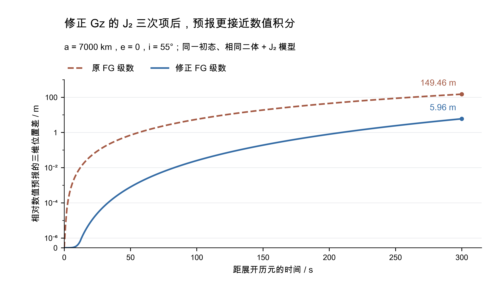

# ASTER 1.4.1 发布验收

本版修正 **FG 级数中 Gz 的 J₂ 附加三次项**，四个含 J₂ 分支的分母由 2 改为 6。独立求导和原生 C++ 检查确认了正确系数；同一初态、相同二体＋J₂ 模型下，低轨示例 300 s 的预报位置差由 **149.46 m 降至 5.96 m**。Mac 与 Linux 的正式版、论文实验版共四套构建中，55 份同名科学输出全部逐字节一致。

## 修正内容与依据

GL 和 GLML 共用 `Lagrange_Coefficients`。本次只修改 J₂、J₂＋日、J₂＋月、J₂＋日月四个分支的这一数值系数，纯二体部分保持原样。最近一次科学变化版本因此只将 GL、GLML 更新为 1.4.1；其他程序的版本归属见[程序变更表](../03_programs.md#program-changes)。

该写法在刘林、张巍 2009 年综述第 73 页式（18）和陈酊存等 2026 年 ASR 论文附录 A 式（A.4）中均存在，此前程序按文献实现。对标准 J₂ 加速度直接求时间导数，并代回 Fz、Gz 合成的位置展开后，附加三次项的分母必须为 3!。原式将这一附加项放大了 3 倍。文献定位、完整推导、适用模型和定轨影响集中在[公式修正验证](16_iod-j2-cubic.md)。



图采用 a=7000 km、e=0、i=55° 的同一物理初态，基准为相同地球质点引力＋标准 J₂ 加速度的 DOP853 积分。120 s 的位置差从 9.6533 m 降至 0.06251 m，300 s 从 149.4554 m 降至 5.96250 m。原生 v1.4.0 与本版预报入口均按随库命令实际编译、运行，全部 601 个正反向时刻复现了图件源数据，表格分量最大差为 9.32×10⁻¹⁰ m。[复现证据](evidence/22_iod-j2-cubic/native_release_check.json)保存基线、所测提交、程序校验和逐时表格差异。

## 对现有初轨的实际影响

同观测对照固定初值、约束、40 次迭代上限和 10⁻¹⁰ 停止判据，只替换四处分母。240 条“预测位置初值＋圆轨道条件”的中轨结果中，迭代次数全部不变，轨道位置变化中位数为 **0.08265 m**、最大 **0.94069 m**；原先默认初值 95 条、预测位置初值 240 条位置误差不超过 300 km 的主要结论保留。960 条四类轨道 GL-O 的严格停止数量与 300 km 内数量也不变。

单侧预报差与最终定轨误差分别统计。固定种子 20261106 的 10 点 GLML 示例中，所选候选由 379 变为 766，最终位置差 6.29 km；其候选来源迭代均达到 40 次上限，角 RMS 接近。完整分组、无人工噪声试验及实测截弧的变化见[同观测影响记录](16_iod-j2-cubic.md#对现有初轨结果的实际影响)。

## 两端构建与检查

发布代表检查的正式线源码提交为 `04a3d8f11a9f740e4c6d5e274993e864d6814619`，实验线为 `83baa38eba7c158a8fd7530d4cc57edfe4b55c36`。后续发布收尾只补充文档与证据，科学代码、输入和依赖保持同一份；最终程序重新配置、链接，使版本查询显示最终标签对应的提交。

| 检查 | Mac arm64 / AppleClang 21 | Linux x86_64 / GCC 13.3 |
| --- | --- | --- |
| 独立 `build/v1.4.1` 全目标 Release 构建 | 通过 | 通过 |
| 当前回归 | 23 项通过；版本入口补齐后另有 3 项针对性检查通过 | 最终科学候选的 23 项通过 |
| Gz 三次项独立回归 | 25 个状态／模型组合通过 | 25 个状态／模型组合通过 |
| 十三程序版本、构建提交、帮助及代表算例 | 通过，GLML 固定种子 20261106 | 通过，相同种子与输入 |
| 两套 20×20＋固体潮 600 s 预报 | 通过 | 通过 |
| 55 份同名科学输出 | 与 Linux 及论文实验版全部逐字节一致 | 与 Mac 及论文实验版全部逐字节一致 |

Mac 的完整回归在 `eb3a8f8` 上运行；随后补齐测距程序的版本信息及归档版检查，再在上述最终科学候选上完成针对性检查与十三程序发布检查。所有所测提交、检查日志、版本字符串、输入摘要和逐文件 SHA-256 均保存在[本版验收 JSON](evidence/23_release-1.4.1.json)。四套构建采用相同 OpenLibm 0.8.8、Eigen 3.4.0、SOFA 2018-01-30，科学文件的校验不包含机器路径和运行耗时。

## 复查与版本管理

在源码根目录执行，输出目录使用新的运行名称；Linux 配置时补充[服务器现有 Boost 路径](../10_server.md)。

```sh
cmake -S . -B build/v1.4.1 -DCMAKE_BUILD_TYPE=Release -DBUILD_TESTING=ON
cmake --build build/v1.4.1 --parallel 3
ctest --test-dir build/v1.4.1 -R '^core_iod_lagrange_j2$' --output-on-failure
python3 tests/release_smoke.py --bin-dir build/v1.4.1/bin \
    --output build/v1.4.1/acceptance/new-run --seed 20261106
```

十三程序的 `--version` 显示完整版本、数学后端、Git 提交和配置时的源码状态；GL、GLML 的任务报告保存相同信息。正式标签为 `v1.4.1`，论文实验阶段使用独立的 `v1.4.1-thesis.1`，已验证的原 CPU 优化阶段补建历史标签 `v1.4.0-thesis.1`。历史标签及原构建、原结果均保留；新运行使用对应版本目录。编号、分支、标签及输入记录的维护规则见[开发维护](../09_development.md#论文实验版本)。
