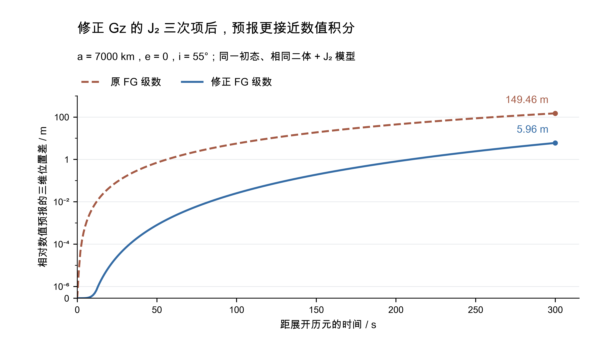

# ASTER 1.4.1-thesis.1 发布验收

本版将论文实验线固定为 **v1.4.1-thesis.1**，保留原有 GLML 候选报告延后生成与同历元日月距离复用，并纳入正式版 1.4.1 的 **Gz 的 J₂ 附加三次项修正**。Mac、Linux 的实验版及正式版共四套构建，55 份同名科学输出全部逐字节一致；日月距离复用与完整迭代历史专项检查通过。

## 本版包含的两个阶段

首次 CPU 优化的实际代码提交为 `19bab2408ee54519eb78f7646079cb292340e91d`，2026-11-05 完成验证。本次为它补建历史标签 `v1.4.0-thesis.1`；当时程序仍显示 1.4.0，既有二进制和耗时结果继续保存。原来测得的候选、数值历史、五次完整进程耗时与条件均在[CPU 实验记录](15_thesis-cpu.md)，该表对应 J₂ 修正前的两套实现。

当前实验版在上述性能实现上加入相同公共修正，完整版本显示为 1.4.1-thesis.1。四个含 J₂ 分支的 Gz 附加三次项分母由 2 改为 6；声明与实现保留本分支已有的日月距离复用接口。标准加速度求导、图件与相同观测定轨比较见[公式修正验证](16_iod-j2-cubic.md)。



低轨示例的 120 s 位置差从 9.6533 m 降至 0.06251 m，300 s 从 149.4554 m 降至 5.96250 m。240 条中轨“预测位置初值＋圆轨道条件”的迭代次数全部不变，轨道位置变化中位数为 0.08265 m、最大 0.94069 m。单侧预报与最终初轨的比较条件、候选变化及全部分组统计均在上述验证说明中。

## 实验版的两端验收

本轮发布代表检查所测实验源码为 `83baa38eba7c158a8fd7530d4cc57edfe4b55c36`，相同公共修正的正式线为 `04a3d8f11a9f740e4c6d5e274993e864d6814619`。随后仅补充验收说明与证据；最终发布提交重新配置、链接并检查版本，保留已测科学实现。

| 检查 | Mac arm64 / AppleClang 21 | Linux x86_64 / GCC 13.3 |
| --- | --- | --- |
| 独立 1.4.1-thesis.1 全目标 Release 构建 | 通过 | 通过 |
| 当前回归 | 24 项通过；版本入口补齐后另有 4 项针对性检查通过 | 最终科学候选的 24 项通过 |
| `core_iod_reuse`：五模型、两种迭代方式及报告历史 | 通过 | 通过 |
| Gz 三次项独立回归 | 25 个状态／模型组合通过 | 25 个状态／模型组合通过 |
| 十三程序的完整版本、源码提交、帮助及代表算例 | 通过 | 通过 |
| 55 份科学输出与输入摘要 | 与正式版及 Linux 全部一致 | 与正式版及 Mac 全部一致 |

构建继续使用 OpenLibm 0.8.8、Eigen 3.4.0、SOFA 2018-01-30。发布代表算例固定 GLML 种子 20261106、2 个线程；回归采用 `OMP_NUM_THREADS=1 OMP_DYNAMIC=FALSE`。Mac 的完整回归所测提交为 `d1494a9`，版本入口补齐后在当前候选上复核相应检查及十三程序输出。逐文件校验、全部版本字符串、实际输入摘要、检查日志与提交保存在[本版验收 JSON](evidence/24_release-1.4.1-thesis.1.json)。

## 使用与后续对照

Mac 的构建位于本实验工作树的 `build/v1.4.1-thesis.1`，Linux 的构建位于 `/home/cdc/projects/ASTER/build/v1.4.1-thesis.1`；原 `build/experiment-thesis` 继续保存历史阶段。每次运行同时保留实际配置、输入与模型校验、种子、线程数、程序版本及提交。

在实验源码根目录执行；Linux 配置时按[服务器指南](../10_server.md)填写现有 Boost 路径：

```sh
cmake -S . -B build/v1.4.1-thesis.1 -DCMAKE_BUILD_TYPE=Release -DBUILD_TESTING=ON
cmake --build build/v1.4.1-thesis.1 --parallel 3
ctest --test-dir build/v1.4.1-thesis.1 \
    -R '^(core_iod_reuse|core_iod_lagrange_j2)$' --output-on-failure
python3 tests/release_smoke.py --bin-dir build/v1.4.1-thesis.1/bin \
    --output build/v1.4.1-thesis.1/acceptance/new-run --seed 20261106
```

后续性能比较使用同一公共科学修正的正式版。`tests/thesis/run_comparison.py` 已增加 `--baseline-ref`，默认为 `v1.4.1`，明确核对基线工作树提交；指定其他历史阶段时同时选择相应的源码、程序和配置。新的性能数据与首次 CPU 实验分别保存。

当前阶段由固定标签保存；同一基线上的下一个已验证阶段使用 `v1.4.1-thesis.2`。更换观测、噪声或种子时建立新的运行目录。完整规则见[论文实验版本](../09_development.md#论文实验版本)。
